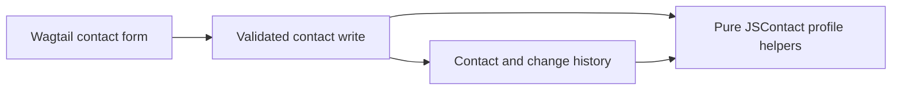

# Initial contact profile

Accepted for the bounded implementation, with a simple Wagtail given-name/surname form. Richer existing name structure is preserved internally; elaborate name editing and structured postal editing are deferred.

## Design paradigm

Keep ordinary Django models and the existing Wagtail `ModelViewSet`. Validated forms and shared contact-write operations use the same profile rules. Profile conversion helpers have no payment-processor dependencies.

## Invariants & rules

### AD-1 — One contact and one name workflow [ADOPTED]

- **Binds:** Contact forms, profile conversion, migration.
- **Prevents:** Duplicate name maintenance, inferred identity and processor-dependent contacts.
- **Rule:** One contact represents one person or organization. Staff edit its name once; known components generate the full representation, while unknown structure stays unstructured. Never parse names into confirmed components, merge on shared details, or infer transaction roles. Use ordinary Given name and Surname fields, neither individually required, with at least one value for new people. No component rows, join controls, naming modes or duplicate editable full name. Keep existing/imported full names without parsing them.

### AD-2 — Bounded JSContact profile

- **Binds:** Model validation, forms, conversion helpers.
- **Prevents:** Incompatible field meanings or accidental full-standard claims.
- **Rule:** Use RFC 9553, Card version `1.0`, with the field mapping below. Staff never edit raw JSON. Conversion helpers are pure: decoding validates and returns data without writing contacts or inferring identity. Unsupported input fails explicitly before mutation. No bulk/source importer or conversion endpoint is introduced; this contact-only Card is not the complete organizational export in FR-16.

| Supported value | JSContact mapping | Initial limit |
| --- | --- | --- |
| Independent UUIDv4 | `uid` as `urn:uuid:…` | Keep existing database PKs and routes. |
| Existing person/organization kind | `kind`: `individual` / `org` | Companies and nonprofits both map to `org`. |
| One current name | `name.full`; optional `components`, `isOrdered`, `defaultSeparator` | Kinds `given`, `surname`, `surname2`, `separator`; repeated kinds allowed. Structured input requires explicit order/separators; generate `full`, rejecting a conflicting supplied full value. No inferred locale or transliteration. |
| One optional correspondence email | `emails.correspondence.address` | Omit map when absent; no preference/context or attribution inferred. |
| One optional postal address | `addresses.correspondence.full` | Multiline Unicode text. No separate country/state/postcode fields or address parser in this increment. |
| Exchange envelope | `@type: Card`, `version: 1.0` | Ordinary contact export; exclude audit/source evidence from the Card. |

Profile validation: components must be nonempty and contain a nonseparator, with `isOrdered: true` and explicit `defaultSeparator` (including empty). An intervening `separator` replaces the default; reject adjacent/leading/trailing separator components and unsupported kinds. Only a complete valid save changes a name, preserving prior values/structure in history. The ordinary Wagtail form edits only given name and surname; generate the full representation. New names use given then surname and an ordinary space when both are present. Explicitly known simple components may populate these fields; preserve the original name object on unchanged saves, including its existing ordering/formatting. Names outside the simple editor remain recorded context, with blank replacement fields retaining them during correspondence edits. Never split supplied text. Richer name editing is deferred until demonstrated need. Use fixed map key `correspondence` in this profile; it is an application identifier, not standardized delivery intent. More entries/other keys are unsupported. Preserve invalid legacy email in storage; encoding it fails explicitly without modifying it.

[ASSUMPTION] Pin CLDR 49 / UTS #35 revision 79 as the formatting reference, but implement only explicit JSContact ordering/separators for these examples. This is a proposed limitation, not a claim of locale-aware CLDR formatting; locale-driven patterns wait for known needs. Blank email/address values do not invalidate contacts or establish delivery readiness. Future adapters must retain original observations and additional emails separately from correspondence and attribution.

### AD-3 — Preserve records and history [ADOPTED]

- **Binds:** Migration, writes, permissions, profile round-trip.
- **Prevents:** Lost legacy data, untraceable edits and accidental access expansion.
- **Rule:** Preserve PKs, kind, exact legacy name/email values; copy names to unstructured `name.full` and assign distinct UIDs. Infer no components, verification, preferences or attribution. Record migration baseline, create, update and delete snapshots: old/new values (absent before create/after delete), UID, actor/time/origin. Migration timestamps describe migration time, with no invented human reviewer. Shared write operations validate explicitly and atomically persist contact/history; forms, viewset mutation hooks and demo seeding must use them. Retain permission codenames, namespace and endpoint enforcement. History survives contact deletion; no cascading removal. Profile helpers introduce no new access capability.

## Django/Wagtail seed

`Contact` remains the owner: UUID UID, validated name `JSONField`, derived `display_name` text for list/search, existing email/kind, and multiline postal text. The Wagtail form exposes ordinary given-name/surname inputs for people and one organization-name input for organizations; it writes the canonical name internally. A minimal form script shows and enables only the relevant kind-specific fields. A rendered name is read-only/derived, not a second source of truth. `ContactHistory` stores private before/after snapshots, exposed through the existing Wagtail History route with changed-field summaries and collapsed complete snapshots. Inspect links there and omits the routine UUID; Wagtail’s own audit log records are retained. The model kind field uses the staff label Contact type; a hidden revision check rejects stale edits. Shared services use the database router, transactions and row locks where supported. This is not a general audit platform or validation of production database concurrency.

| Existing framework | Locked version |
| --- | --- |
| Django | 5.2.19 |
| Wagtail | 7.4.4 |

## Mapping boundaries and deferred work

Mapping notes only: `individual`/`org` → Schema.org Person/Organization; rendered name → `name`; email → `email`; postal text → `address` as text. Structured postal address editing, parsed PostalAddress and separate ContactPoint mappings are explicitly deferred. Future vCard 4.0 (RFC 6350) FN/N/KIND/EMAIL/ADR mappings follow RFC 9555/9554, with losses documented before converters. Additional components, source imports, provider identities, relationships, multiple details, routing, finances, letters and sending are deferred. Future issuance must snapshot names; this PR introduces no letter records. Deployment decisions remain outside this increment; retain the existing synthetic devsite and CI.

## References

[RFC 9553](https://www.rfc-editor.org/rfc/rfc9553.html), [RFC 9554](https://www.rfc-editor.org/rfc/rfc9554.html), [RFC 9555](https://www.rfc-editor.org/rfc/rfc9555.html), [CLDR 49](https://www.unicode.org/reports/tr35/tr35-79/tr35-personNames.html), [Django 5.2 migrations](https://docs.djangoproject.com/en/5.2/topics/migrations/), [Wagtail 7.4 generic views](https://docs.wagtail.org/en/v7.4/extending/generic_views.html).
